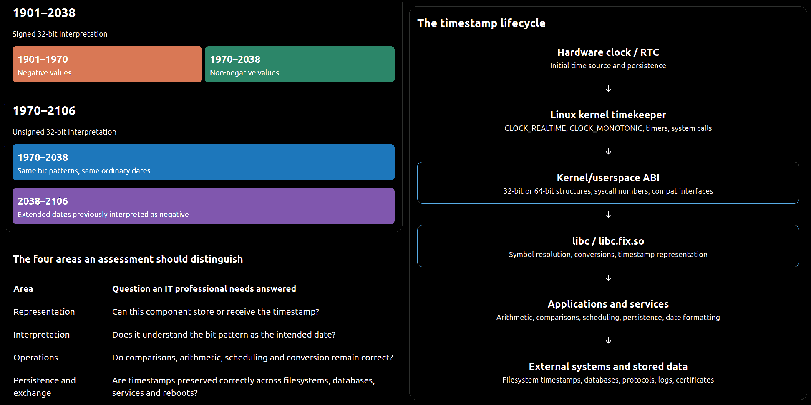

# libc.fix 2038 (32-bit)

**Source code available under MIT license**

- Origin: [lists.busybox.net/pipermail/busybox/2026-November/092584.html](https://lists.busybox.net/pipermail/busybox/2026-November/092584.html)

- Index: [Rationale](#rationale) &nbsp;&middot;&nbsp; [Mitigation](#lightweight-y2k38-mitigation) &nbsp;&middot;&nbsp; [How It Works](#how-it-works) &nbsp;&middot;&nbsp; [Building](#building) &nbsp;&middot;&nbsp; [Deployment](#deployment--usage)

Lightweight Y2K38 mitigation wrapper for 32-bit legacy systems (2106 extension), in few KB.

<br>

## Rationale

The Y2K38 is 12 years ahead, it might sound like a long runway in the fast-moving world of web and consumer software, it is actually right inside the active operational lifecycle of many embedded systems deployed today. Many devices manufactured and installed right now are expected to stay in service for 15, 20, or even 30 years. If a 32-bit system is deployed today, it will still be running well past January 19, 2038.

### Target sectors of application

The types of 32-bit systems that need to plan and schedule for Y2K38 well in advance include:

* Industrial Control Systems (ICS) & SCADA
* Critical Infrastructure & Utilities
* Transportation & Automotive
* Aerospace & Defense
* Medical Devices

### Why planning can't wait 2037

For short-lived consumer gadgets, ignoring Y2K38 for now might be fine. Instead, for long-term embedded infrastructure, 12 years goes by quickly. Y2K38 isn't just about the exact second the clock strikes 2038.

**Future-Dated Logic Triggers Early**: Systems frequently handle future timestamps — such as multi-year maintenance schedules, 10-year SSL/TLS certificates, financial contracts, or predictive maintenance logs — meaning calculations will start failing years before 2038.

**Supply Chain & Replacement Lead Times**: Replacing millions of deployed edge devices or rewriting proprietary, closed-source or legacy firmware takes years of asset discovery, testing, and staged rollouts.

<br>

## Lightweight Y2K38 Mitigation 

This lightweight Y2K38 mitigation for 32-bit embedded Linux (2106 extension) is a minimal, zero-dependency C shared library (`libc.fix.so`, ~few KB) designed to extend the operational lifespan of legacy 32-bit Linux embedded systems and BusyBox environments from **January 19, 2038** (`0x7FFFFFFF`) up to **February 7, 2106** (`0xFFFFFFFF`).

Built specifically for deployed hardware running legacy kernels and closed-source userland binaries where migrating to 64-bit `time_t` (`_TIME_BITS=64`) or recompiling the firmware is not feasible. However, there is an important distinction between extending the range of a timestamp representation and making existing applications understand that extended range.

> [!WARNING]
>
> **LIMITITATIONS APPLY**
> 
> * **The Pre-1970 Blind Spot**: it is a fundamentally flawed approach for systems that rely on timestamps before January 1, 1970 (UNIX epoch). Because standard 32-bit `time_t` is signed 32-bit integers, historical dates are represented as negative numbers while the unsigned wraps after 2038.
>
> * **ABI Boundary Mismatch**: if a precompiled binary passes `time_t` pointers into kernel system calls directly (via raw syscalls rather than wrapped libc functions), the kernel will still interpret them as signed 32-bit integers, causing immediate overflow failures in 2038.
>
> * **Static Closed-Source**: the `LD_PRELOAD` and `/etc/ld.so.preload` apply to all dynamically linked executables. Statically linked binaries bypass the dynamic linker and will not load preloaded libraries. If the binary is closed-source and statically linked, `libc.fix` cannot hook into it.
>
> * **Non-Reentrant calls**: some functions rely on non-reentrant functions that return pointers to internal static storage. These dependencies introduce shared mutable state and potential interference between concurrent or nested calls. Further evaluation and refactoring are required, yet.

<br>

## How It Works

Instead of altering the 4-byte `time_t` ABI — which would corrupt stack layouts and registers in pre-compiled 32-bit binaries — `libc.fix.so` intercepts standard `<time.h>` calls via `LD_PRELOAD` (or `/etc/ld.so.preload`) and reinterprets the 32-bit epoch counter as an **unsigned integer** (`0` to `4,294,967,295` seconds).



### Key Technical Features

* **ABI-32-bit Unsigned Reinterpretation:** Keeps `sizeof(time_t) == 4` intact at the binary boundary while performing all internal calendar and epoch math using `unsigned int`, unlocking an extra ~68 years (2,147,483,648 seconds) with zero binary recompilation.

* **Two-Step Kernel Clock Stepping (`clock_adjtime`):** Legacy 32-bit kernels reject single clock jumps larger than `±2^31 - 1` seconds (`EINVAL`). `lucy_set_rtcc_tp()` uses `ADJ_SETOFFSET | ADJ_NANO` split across up to two bounded steps (`±2,147,385,600,000,000,000 ns`, ~68.09 years per step) to smoothly step the kernel timekeeper from 1970 directly into post-2038 dates.

* **Nanosecond Phase Preservation:** Tracks `struct timespec` in RAM and applies adjustments directly in nanoseconds (`ADJ_NANO`) using pure 64-bit integer arithmetic, avoiding 0.5-second rounding drift.

* **Minimal Footprint:** Pure C with integer arithmetic and no external dependencies beyond standard `libc` syscalls (`clock_gettime`, `clock_adjtime`). Ideal for flash- and RAM-constrained embedded devices.

* **BusyBox & Legacy Daemon Compatible:** Works seamlessly with dynamically linked BusyBox applets (`date`, `crond`, `syslogd`, `ntpd`, `httpd`) and proprietary userland services.

### Intercepted Functions

* `time()`, `stime()`, `gettimeofday()`, `settimeofday()`
* `gmtime()`, `gmtime_r()`, `localtime()`, `localtime_r()`
* `mktime()`, `timegm()`, `timelocal()`
* `asctime()`, `asctime_r()`, `ctime()`, `ctime_r()`
* `strftime()` *(includes custom `%n` total epoch nanoseconds and `%N` fractional nanoseconds)*

<br>

## Building

Compiling on 64-bit systems isn't relevant but it compiles.

### Native Compilation

```bash
make all
```
or
```bash
make CFLAGS="-DOLD_TOOL_CHAIN" all
```

The expected result on a 64-bit system is a failure:

```text
rm -f time.o libc.fix.so
gcc -O2 -Wall -Wextra -fPIC -D_GNU_SOURCE -c time.c -o time.o
gcc -shared -Wl,-soname,libc.fix.so -o libc.fix.so time.o -ldl
strip --strip-unneeded libc.fix.so
size libc.fix.so
   text	   data	    bss	    dec	    hex	filename
  12451	   1152	    152	  13755	   35bb	libc.fix.so
date
Wed 18 Nov 08:02:34 CET 2026
LD_PRELOAD=./libc.fix.so date
Wed 18 Nov 07:02:34  2026
date -d "2045-06-15 12:34:56"
Thu 15 Jun 12:34:56 CEST 2045
LD_PRELOAD=./libc.fix.so date -d "2045-06-15 12:34:56"
date: invalid date ‘2045-06-15 12:34:56’
make: *** [Makefile:40: tests] Error 1
```

### Cross Compilation

```bash
# Generic ARM 32-bit (Buildroot / OpenWrt / armhf)
make CROSS_COMPILE=arm-linux-gnueabihf-

# Qualcomm MDM9607 / OpenEmbedded / Yocto
make CROSS_COMPILE=arm-oe-linux-gnueabi- \
CFLAGS="-O2 -march=armv7-a -mfloat-abi=softfp -mfpu=neon -fPIC -D_GNU_SOURCE"

# MIPS 32-bit
make CROSS_COMPILE=mipsel-linux-gnu-
```

### Container Compilation

Alpine 32-bit container compilation with musl, for example:

```bash
# Container preparation:
docker run -it i386/alpine:latest /bin/sh
# Inside the container:
apk update
apk add build-base musl-dev
exit

# get the container id with
docker ps -a | grep i386/alpine:latest

# after grabbed the container id
docker commit $cont-id alpine-i386-dev
docker rename $cont-id alpine-i386-dev

devc="-u $(id -u):$(id -g) -v .:/src -w /src alpine-i386-dev"
export devc
```

- How to [Preparing the container for building](https://github.com/robang74/uchaosys/blob/v074/kdev/umkaos32.md#preparing-the-container-for-building) in full, from μChaoSys `umkaos32` instructions.

```bash
test -e src || ln -s . src
docker run -it --rm $devc /bin/ash -c "make all"
```

> [!NOTE]
> 
> Alpine 32-bit w/ musl already support 64-bit extended `time_t` by `_TIME_BITS=64`.

```text
rm -f time.o libc.fix.so
gcc -O2 -Wall -Wextra -fPIC -D_GNU_SOURCE -c time.c -o time.o
gcc -shared -Wl,-soname,libc.fix.so -o libc.fix.so time.o -ldl
strip --strip-unneeded libc.fix.so
size libc.fix.so
   text	   data	    bss	    dec	    hex	filename
  14051	    612	    140	  14803	   39d3	libc.fix.so
date
Wed Nov 18 06:28:08 UTC 2026
LD_PRELOAD=./libc.fix.so date
Wed Nov 18 06:28:08 +00:00 2026
date -d "2045-06-15 12:34:56"
Thu Jun 15 12:34:56 UTC 2045
LD_PRELOAD=./libc.fix.so date -d "2045-06-15 12:34:56"
Wed Jun 15 12:34:56 +00:00 2045
```

### Full 32-bit Testing

To test the `lib.fix.so` in a full 32-bit container the candidates are, in order of smaller image size:

- `i386/ubuntu:14.04`, `i386/centos:6` and `i386/debian:jessie`

For Ubuntu, the instructions for installing the necessary packages are:

- `apt-get update && apt-get install -y build-essential`

The expected result on a full 32-bit system is a failure without `libc.fix.so` and a success when the fix applies:

```text
rm -f time.o libc.fix.so
gcc -DOLD_TOOL_CHAIN -c time.c -o time.o
gcc -shared -Wl,-soname,libc.fix.so -o libc.fix.so time.o -ldl
strip --strip-unneeded libc.fix.so
size libc.fix.so
   text	   data	    bss	    dec	    hex	filename
  14380	    516	    160	  15056	   3ad0	libc.fix.so
date
Wed Nov 18 07:24:51 UTC 2026
LD_PRELOAD=./libc.fix.so date
Wed Nov 18 07:24:51  2026
date -d "2045-06-15 12:34:56" || true
date: invalid date '2045-06-15 12:34:56'
LD_PRELOAD=./libc.fix.so date -d "2045-06-15 12:34:56"
Thu Jun 15 12:34:56  2045
```

Pre-cooked copy-paste recipes are fantastic for instant gratification. They let a user verify that the code builds and runs in under two minutes without having to think about environment setup.

Unfortunately, this is the one of the most unsuitable cases for such an approach since it is a kind of hacking a userland system layer for a legacy 32-bit system. Therefore, also emulation should be very specific.

In fact, most developers are working on modern x64 (64-bit) Linux hosts or macOS/Windows via WSL2, running i386-container relies entirely on transparent user-space emulation (`qemu-user` via `binfmt_misc`).

<br>

## Deployment & Usage

> [!WARNING]
> 
> **Kernel vs Userland date/time interpretation mismatch risks**
> 
> Following examples have been elaborated by a non-exhaustive set of scenarios simulation supported by AI because every production-ready assessment strictly requires a customised testsuite checking the whole system running on the very specific real hardware, not even on a virtual machine.

For example, on a full 32-bit system, when `root` sets the date/time to `2045-06-15 12:34:56`, an *un-preloaded* userland daemon writes it, in `/var/log/syslog`, within the `1901-to-1970` range while an application under `libc.fix.so` would have displayed a date within the `2038-to-2106` range.

To manage this gap, the `libc.fix.so` intercepts the `date -s` syscall in a way the kernel adds an offset. However, the fact that `ADJ_SETOFFSET` exists since Linux 2.6.39 does not guarantee, by itself, a full Y2038-safe internal timekeeping and a negative value can be provided.

When the kernel correctly interpretes the offset into the `2038-to-2106` range by `ADJ_SETOFFSET`, the applications which aren't under the `libc.fix.so` receive a negative value, by reading the `time()` from a bare syscall, which falls within the `1901-to-1970` range.

While an `EOVERFLOW` is triggered when a modern or mixed-ABI user-space component attempts to coerce a legacy 32-bit time value into 64-bit structures. Therefore, presuming 64-bit Y2038-safe applications would interoperate seamlessly, is a hazardous bet unless checking.

A comparable discrepancy occurs when the `printk()` writes a date/time read from a { filesystem, network, firmware, chips } which could be found checking by `dmesg`. While monotonic booting timestamps refers to the ticking subsystem T=`[0.000]` initialisation, instead.

---

### 1. Test on a single command

```bash
LD_PRELOAD=/path/to/libc.fix.so date -d "2045-06-15 12:34:56"
LD_PRELOAD=/path/to/libc.fix.so date
```

### 2. System-wide activation

Copy `libc.fix.so` to `/lib/` (or `/data/lib/` on read-only root filesystems) and register it in `/etc/ld.so.preload`:

```bash
cp libc.fix.so /lib/libc.fix.so
chmod 0755 /lib/libc.fix.so
echo "/lib/libc.fix.so" > /etc/ld.so.preload
```

### 3. Copyright & License

This project is being used to demonstrate capability and generate commercial opportunity by a MVP-oriented commercial demonstration, not to offer development for free. Which, essentially, is the distinction between open-source visibility and commercial engineering. The MIT license choice only indicates the will to not enforce any kind of source-sharing obligation over those that haven't it beforehands (or not anymore).

**Sources**: `time.c`, `time.h` and `makefile`

- `Copyright (c) 2026, [LuCy] <luchoas26@gmail.com>, MIT License`
- `Copyright (c) 2026, Roberto A. Foglietta <roberto.foglietta@gmail.com>`

**Manual**: `README.md`

- `(c) 2026, [LuCy] <luchoas26@gmail.com>, MIT License in origin`
- `(c) 2026, Creative Commons Attribution-NonCommercial 4.0 International, by RAF`

#### Credits

- Original technical concept by `LuCy`. Hardening, portability, validation and project engineering by `RAF`. 
